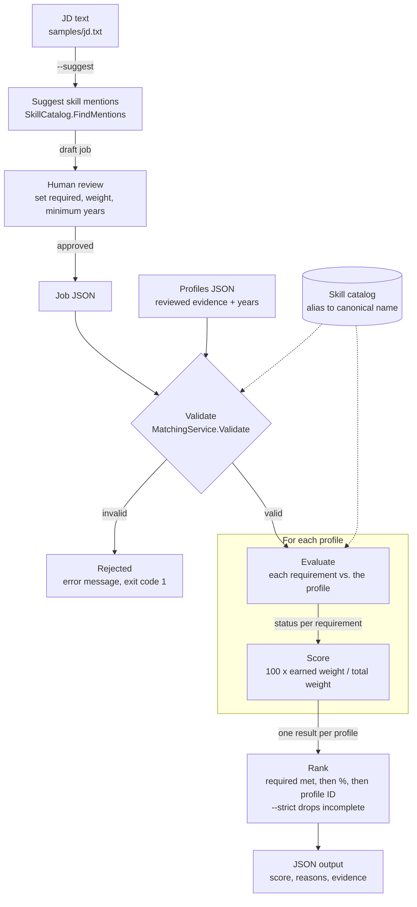
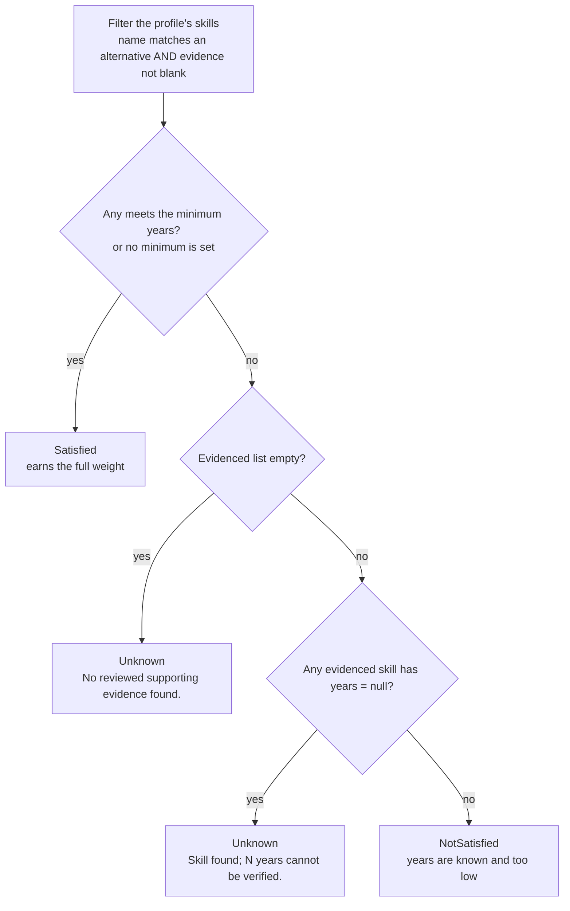

# JD and profile matching with C# and LINQ

A runnable console prototype using .NET 10, with no external package dependencies.

## Run

From this folder:

```sh
dotnet run
dotnet run -- --self-test
dotnet run -- --job samples/job.json --profiles samples/profiles.json
dotnet run -- --job samples/job.json --profiles samples/profiles.json --strict
```

Default output is JSON including the score, required coverage, per-requirement status, explanation and supporting evidence. Expected order: Meera (90%, all required supported), Arjun (90%, Azure unknown), Ravi (45%, insufficient C# years and Azure unknown). Strict mode returns only Meera. Empty profile collections return no matches; an empty requirement list is an error.

## Accept a JD as text

```sh
dotnet run -- --suggest samples/jd.txt > suggested-job.json
```

This creates a draft job with detected skill mentions. **Review it before matching.** Set each requirement's `required`, `weight` and `minimumYears` values. The defaults (equal weight, optional, no minimum years) are placeholders. The matching command treats the supplied job JSON as reviewed configuration; it does not enforce review through a UI.

Mention detection does not understand negation, required/preferred wording, experience durations or alternatives. For example, “no Azure experience required” still suggests Azure. It will not infer proficiency from that mention. The catalog is intentionally small and can be extended in SkillCatalog.cs. Unknown structured skill names are compared as case-insensitive exact names.

Profiles are supplied as **reviewed structured evidence**, not raw resumes. Document parsing and automatic profile interpretation are outside this prototype. The caller must exclude negated, aspirational or unsupported claims. A nonblank evidence field is not independently verified by this program. Per-skill years must come from reviewed evidence; never substitute total career years or sum overlapping projects. Multiple records for the same skill are checked independently, not added together.

## Matching policy

1. Normalize skill aliases, preserving technology identity.
2. Evaluate each reviewed requirement against the profile's skill evidence.
3. Award a requirement's weight once when at least one alternative meets every condition.
4. Missing evidence or unknown years produces `Unknown`; explicitly insufficient years produces `NotSatisfied`. Both earn zero points.
5. Calculate `100 × earned weight / total JD weight`, rounded to two decimals.
6. Rank profiles with all required requirements supported first, then by percentage, then profile ID for stable ties. Strict mode excludes all other profiles.

Weights must be positive; minimum years must be nonnegative. Repeating a canonical skill across requirements is rejected to prevent accidental double counting. A group such as Azure OR AWS is represented as:

```json
{ "label": "Cloud platform", "anyOf": ["Azure", "AWS"], "weight": 10, "required": true }
```

If minimum years is set on an alternative group, it applies to each alternative individually. Extra candidate skills have no penalty. An optional requirement affects the score but never strict eligibility. With no required requirements, all profiles satisfy the required-coverage policy.

## Design and extension points

### End-to-end flow



### How one requirement is judged

`MatchingService.Evaluate(requirement, profile)` runs these checks in order and stops at the first match.



Only `Satisfied` earns points. `Unknown` and `NotSatisfied` both earn 0.

### Worked example

Sample job: C# Backend Developer, total weight 100. C# needs at least 3 years.

| Requirement (weight) | Meera | Arjun | Ravi |
|---|---|---|---|
| C# (35, required, 3+ years) | Satisfied (5 yrs) | Satisfied ("C Sharp", 4 yrs) | NotSatisfied (2 yrs) |
| ASP.NET Core (25, required) | Satisfied | Satisfied | Satisfied |
| SQL Server (20, required) | Satisfied | Satisfied ("MSSQL") | Satisfied |
| Azure (10, required) | Satisfied | Unknown | Unknown |
| Docker (10, optional) | Unknown | Satisfied | Unknown |
| **Score** | **90%** | **90%** | **45%** |
| All required met | Yes | No | No |
| **Rank** | **1st** | **2nd** | **3rd** |

Meera and Arjun tie at 90%, but Meera ranks first because every required item is met. With `--strict`, only Meera is returned.

- Models.cs defines the inputs and outputs.
- SkillCatalog.cs resolves aliases and suggests mentions from text.
- MatchingService.cs contains LINQ matching and ranking.
- Program.cs provides the console interface.
- SelfTests.cs checks scoring and meaningful edge cases without a test-package dependency.

This implementation evaluates all supplied profiles in memory. For production, store normalized skill evidence, retrieve a broad candidate set with indexed database queries, and then apply the same requirement policy. Add PDF/Word extraction and a reviewed extraction workflow separately. Persist catalog/scoring versions with results if historical reproducibility is required. The percentage is requirement coverage, not hiring probability.
